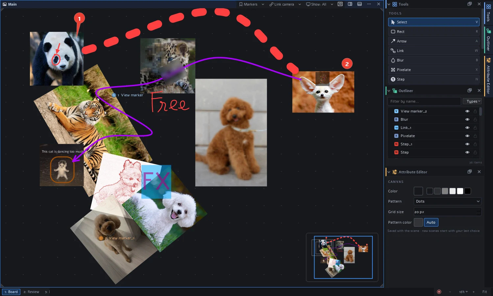
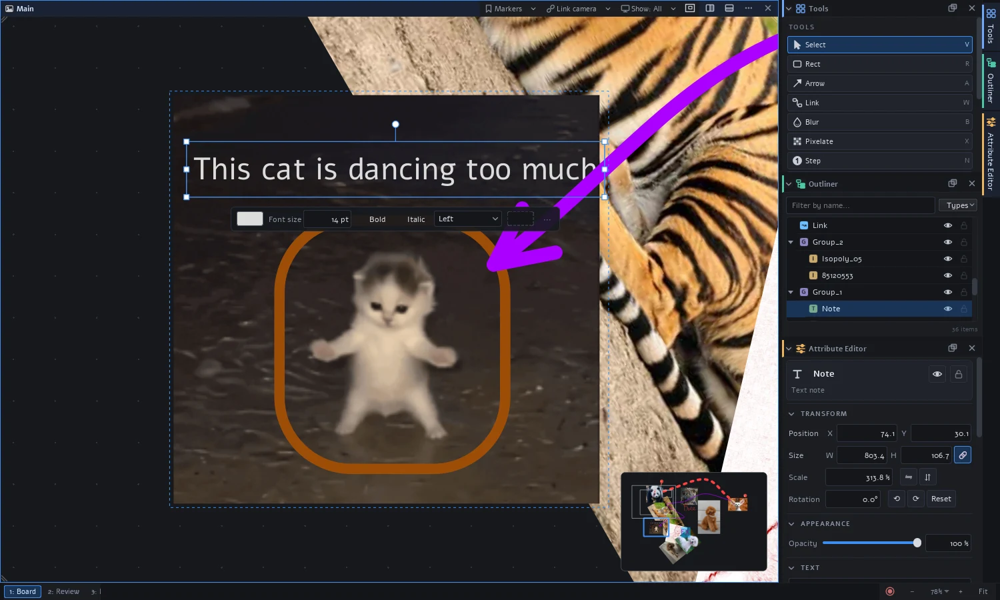
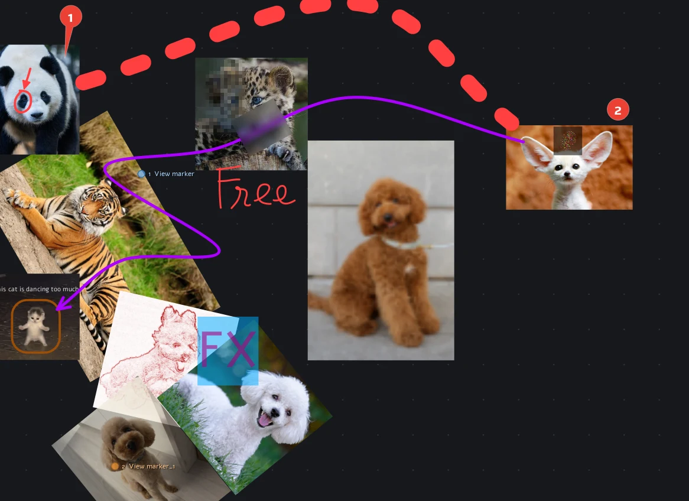
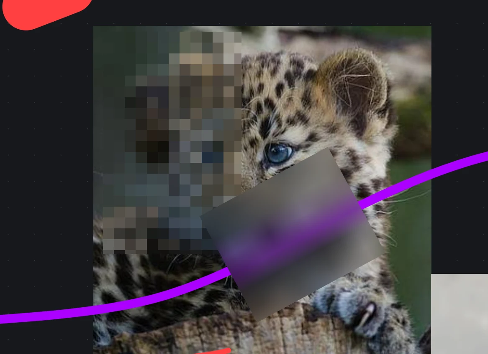
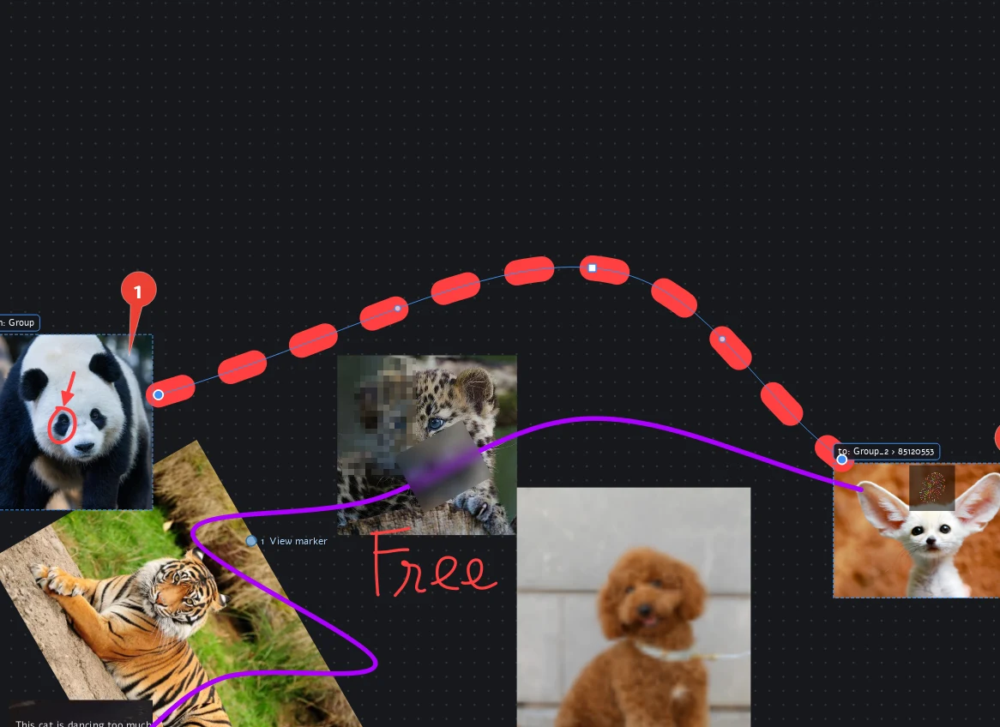
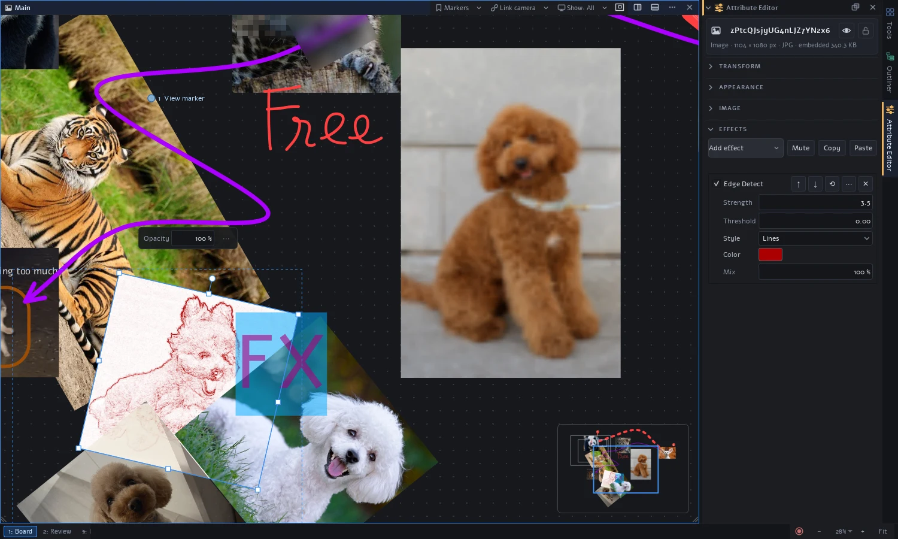
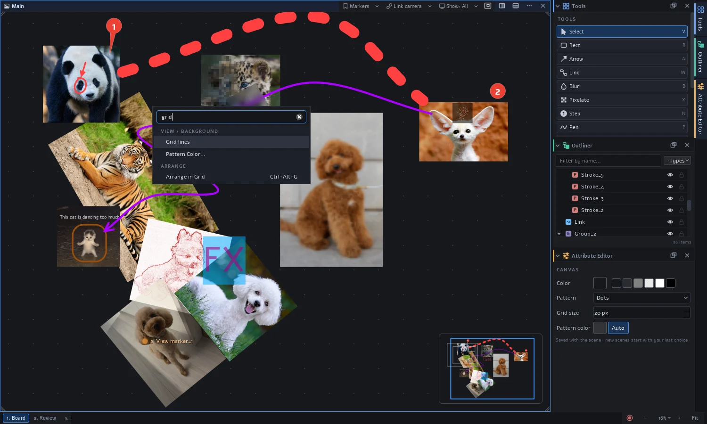
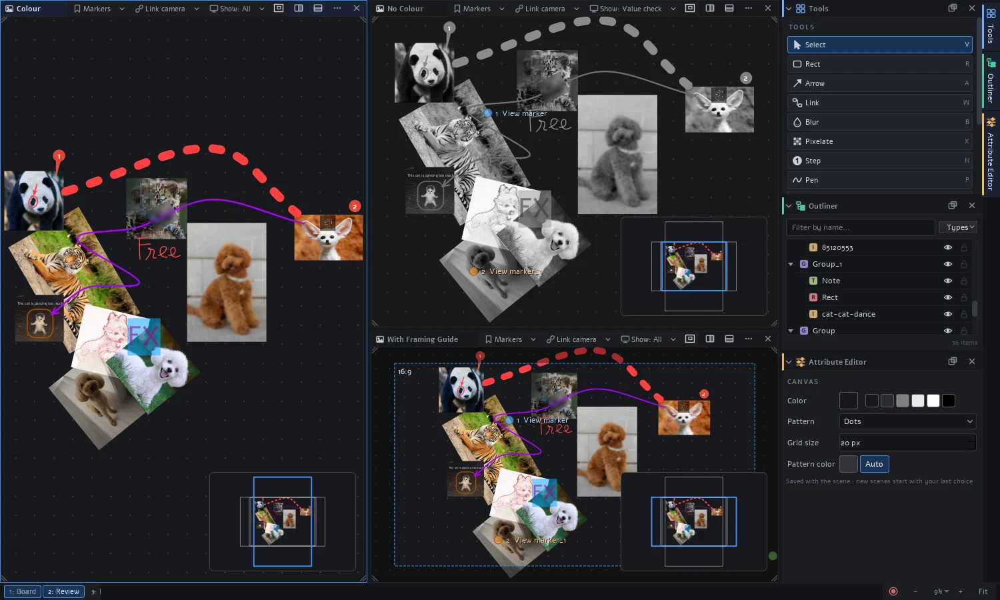
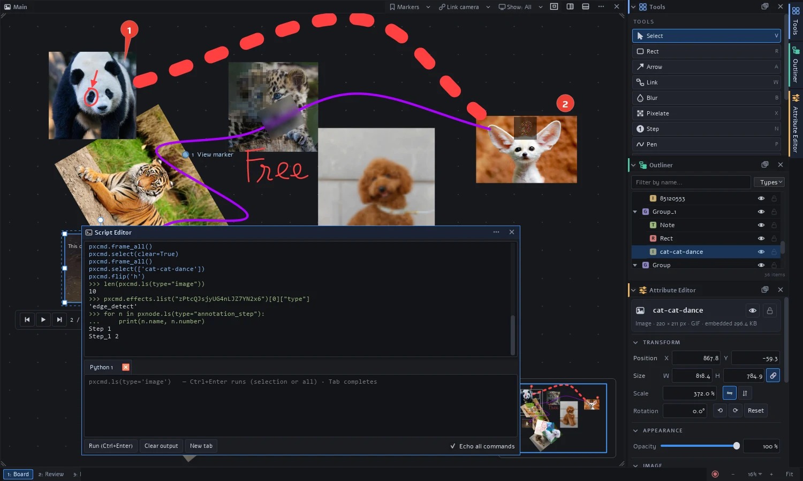

# pixelRef

An infinite-canvas reference board, like PureRef or BeeRef, built the way DCC
applications are built. Drop in images and GIFs, mark them up, link them
together and look at them through as many views as you like. Everything you
do with the mouse is also a Python command, and every feature is a plugin you
can replace or extend.



- **Collect** images, folders, GIFs and browser images by pasting or dragging.
  One `.pxref` file holds the board and its images.
- **Mark up** with text notes, rectangles, arrows, the pen, numbered steps,
  and blur or pixelate regions.
- **Connect** elements with links that follow them around.
- **Process** any element with a stack of effects (grayscale, blur, edge
  detect…).
- **Look** through any number of views, tiled i3-style, with their own
  cameras, value checks and framing guides.
- **Automate** with the Script Editor, recorded macros, your own keys and
  plugins.

## Install and run

You need Python 3.11 or newer.

```bash
pip install -r requirements.txt          # PySide6
python -m pixelref                       # the desktop app
python -m pixelref board.pxref           # open a scene
```

To build a standalone executable instead, see [Standalone build](#standalone-build).

## A quick tour

The tour uses the sample board that ships with pixelRef. Open it:

```bash
python -m pixelref examples/scenes/animals.pxref
```

Two keys are worth learning first. `Ctrl+K` (or right-click, then type)
searches every command, and `F1` lists every shortcut and lets you change it.

### 1. Move around

- **Zoom** with the wheel. **Pan** with a middle- or right-drag, or
  `Space`+drag.
- `F` frames the selection (or everything), `Shift+F` frames everything, and
  double-clicking an image zooms to it.
- The **minimap** in the corner shows the whole board. Click or drag it to
  jump around.
- **View markers** remember places on the board. The sample has three, shown
  as coloured dots. Press `Ctrl+1` or `Ctrl+2` to fly to them, or use the
  *Markers* menu in the view's header to add your own.

### 2. Bring images in

Paste (`Ctrl+V`) or drag in image files, whole folders, animated GIFs and
WebPs, or images straight from a web browser. Images are **embedded** in the
scene file by default, so a single `.pxref` is easy to share. To keep a large
file on disk instead, choose *Link…* in the Attribute Editor.

### 3. Select, transform and quick-edit

Click to select, drag a rubber band, and `Shift`/`Ctrl`-click to add. The
**gizmo** scales from the corners, stretches from the edges and rotates from
the knob on top (`Shift` snaps to 15°). The arrow keys nudge the selection.

A **quick editor** bar appears under the selection with the settings you
change most. For a text note, that's its colour, size, bold, italic and
alignment. The **Attribute Editor** on the right has everything else.



In the sample, the cat GIF and its note are inside a group (`Group_1`).
Double-click a group to work inside it, and press `Esc` to leave it.

### 4. Annotate

Pick a tool from the Tools panel or press its key. A drawing tool stays active
until `Esc` or `V`.

| Key | Tool | Key | Tool |
| --- | --- | --- | --- |
| `T` | text note | `N` | numbered step marker |
| `R` | rectangle | `B` | blur region |
| `A` | arrow / line | `X` | pixelate region |
| `P` | pen (free drawing) | `W` | link |
| `E` | eraser | `I` | colour picker |



The panda's red circle and arrow are a pen **drawing**, grouped with the photo.
Every stroke you make until `Esc` goes into one drawing, which then moves as a
single object. The handwritten *Free* is another drawing. Step markers count
up as you place them. Drag while placing one to give it a pointer.

### 5. Hide what shouldn't be seen

A **blur** (`B`) or **pixelate** (`X`) region has no pixels of its own. It
shows whatever is beneath it, so it keeps working when you move the image
under it, and exports exactly as you see it. That makes it handy for names,
faces and screen details.



### 6. Link things together

With the Link tool (`W`), drag from one element to another. Links follow
their elements as they move. Drop an end on an element's centre to attach to
the whole element, on an edge to pin to that spot, or anywhere inside to point
at a detail. Drag a selected link's line to add waypoints. The Attribute
Editor sets the path (straight, curved or elbow), caps, dashes and a label.
`Ctrl+L` links the selected elements in order.



### 7. Add effects

Any element can have a **stack of effects**: grayscale, invert,
brightness/contrast, threshold, posterize, blur and edge detect. Plugins can
add more. Add them from the Attribute Editor's *Effects* section, then drag a
setting's field left or right while you watch the canvas. In the sample,
*Edge Detect* turns one dog photo into a red line sketch, and *Blur* softens
the brown poodle. `Shift+G` toggles grayscale on the selected images.



Heavy effects run in the background and are cached in memory, on disk and in
the scene file. The board opens just as fast on another computer.

### 8. Play animations

Animated GIFs and WebPs play on the board. Select one (the dancing cat) to get
playback controls in its quick editor bar. `K` plays and pauses, and `,` / `.`
step one frame back or forward. A paused frame is saved with the scene.

### 9. Arrange and organise

| Key | Does |
| --- | --- |
| `Ctrl+P` | pack the selection (or everything) tightly |
| `Ctrl+Alt+H` / `V` / `G` | lay out in a row / column / grid |
| `]` / `[` | bring to front / send to back |
| `Ctrl+G` / `Ctrl+Shift+G` | group / ungroup |
| `C` | crop the selected image |
| `Shift+H` / `Ctrl+R` | flip / rotate 90° |

The **Outliner** shows the whole hierarchy. Drag in it to reparent, use the
eye and lock columns, filter by name, or use the *Types* menu to show, hide,
isolate or lock every element of one type.

### 10. Find any command

Right-click the canvas and start typing, or press `Ctrl+K`. Every action of
every plugin can be found here, along with its shortcut.



### 11. Views and workspaces

Split a view with the buttons in its header, or by dragging one of its corners
into it. Each view has its own camera and **display preset**: *All*,
*Value check* (greyscale), *Images only*, *Annotations only* or *Clean*. Views
can be linked so that they pan and zoom together.

Views are tiles in an i3-style window manager with **workspaces**. Switch
between them with the buttons at the bottom left. The sample's *Review*
workspace shows a colour view, a value-check view and a view with a 16:9
framing guide:



`Ctrl+W` is the window-mode leader key: `Ctrl+W` then `S` or `V` splits, `H`
`J` `K` `L` move the focus, and `1`–`9` switch workspace. Tap `Space` to
maximise the view under the mouse. Workspaces are saved with the scene.

### 12. Script it

Open the **Script Editor** with ``Ctrl+` ``. With *Echo all commands* turned
on, everything you do in the UI is printed as the `pxcmd` call behind it.
Copy those lines into a script, and you have automated what you just did.



```python
from pixelref import pxcmd, pxnode

img = pxcmd.import_image("refs/castle.jpg", translate=[0, 0])
note = pxcmd.create_node("annotation_text", parent=img, text="Fix this edge")
pxcmd.effects.add("edge_detect", img, style="lines", strength=3)
pxcmd.select(pxcmd.ls(type="image"))
with pxcmd.undo_chunk("Grid layout"):     # one undo step
    pxcmd.arrange(mode="grid")
pxnode.node(img).opacity = 0.5           # the same API, object-style
pxcmd.help("arrange")                    # every command is documented
```

Each run in the Script Editor is one undo step. Scripts can also run without a
window:

```bash
python -m pixelref --batch script.py [scene.pxref] [--save out.pxref]
```

### 13. Make it yours

- **Record a macro.** Click the red record button in the bottom bar (or press
  `Ctrl+Alt+R`), work as usual, then save. The macro becomes a script in the
  *Scripts* menu, and you can give it a key.
- **Change any key** in `F1`, or right-click a tool button and choose
  *Set Shortcut…*. Rearrange the Tools panel with *Customize Palette…*.
- **Drop a `.py` file** into the scripts folder (*Scripts → Open Scripts
  Folder*) to turn it into a command.
- **Install plugins** into the user plugin folder, then enable them in
  *Window → Plugins…*. Plugins that need Python packages install them from
  the same window.

### 14. Save and export

- `Ctrl+S` saves a `.pxref` file with a thumbnail. Recent files show up on the
  start panel of an empty board. Autosave writes a recovery copy every minute.
- `Ctrl+E` renders the selection (or the whole board) to PNG or JPEG.
  `Ctrl+Shift+E` copies the original image files into a folder.
- `Ctrl+T` keeps the window on top, `F11` makes it frameless, and `G` turns
  on ghost mode: a translucent window you can trace over other applications.

## Documentation

| Read | For |
| --- | --- |
| [User guide](docs/user-guide.md) | every feature in detail |
| [Reference for people and AI agents](docs/reference.md) | the whole application on one page: features, keys, data model, API and recipes for scripts, macros, plugins and effects |
| [Keyboard shortcuts, scripts and macros](docs/keymap.md) | `keymap.toml`, the scripts folder, recording macros |
| [Scripting](docs/scripting.md) | `pxcmd`, `pxnode`, the Script Editor, callbacks, batch mode |
| [Command reference](docs/commands.md) | every command, generated from the code |
| [Views and the window manager](docs/window-manager.md) | workspaces, splits, panels, display presets, linked views |
| [Effects](docs/effects.md) | using effects, caching, writing new effect types |
| [Writing plugins](docs/plugins.md) | the plugin API: node types, tools, views, panels, extension points |
| [Architecture](docs/architecture.md) | how the kernel and plugins fit together |
| [File format](docs/file-format.md) | the `.pxref` scene file |
| [Packaging](docs/packaging.md) | the standalone build and managed Python packages |

## Extending pixelRef

Every feature is a plugin in `pixelref/builtins/`, and your plugins use
exactly the same API. A plugin is a folder with a `plugin.toml` and an
`__init__.py` whose `activate(ctx)` registers the headless parts (node types,
commands) and whose `activate_ui(ui)` registers the Qt parts (drawing, tools,
keys, menus, panels).

```bash
python -m pixelref --plugin-path examples/plugins    # load the example ellipse plugin
```

Start with [docs/plugins.md](docs/plugins.md) and the commented
[ellipse example](examples/plugins/ellipse/__init__.py). New effect types are
covered in [docs/effects.md](docs/effects.md#adding-effects-in-a-plugin).
[docs/reference.md](docs/reference.md) has short recipes for each kind of
extension.

## Project layout

```text
pixelref/
  core/          the headless kernel: scene graph, node types, attributes, commands,
                 undo, selection, plugin runtime, .pxref file format
  plugin_api/    everything a plugin may import (headless half + plugin_api.ui)
  ui/            the Qt kernel: App, actions/keymap/menus, canvas document & views,
                 tool manager, input pipeline, window manager
  builtins/      the built-in plugins that provide every feature (tools, panels, file I/O…)
  pxcmd.py       pixelref.pxcmd: the command API
  pxnode.py      pixelref.pxnode: an object-oriented layer over pxcmd
  batch.py       headless batch mode
examples/plugins/ellipse   a complete example plugin
examples/scenes/           the sample board (animals.pxref)
docs/            the documentation listed above; images/ holds the README screenshots
assets/          the logo master artwork
tools/           generators for the command reference, the screenshots and the logo
packaging/       the standalone executable build (PyInstaller) and its smoke test
tests/           headless end-to-end tests
```

## Contributing and tests

Run the tests before sending a change. They are headless and don't need
pytest (pytest works too):

```bash
python tests/run_tests.py              # everything (or: python -m pytest tests)
python tests/run_tests.py test_kernel  # one module (or any name fragment)
```

Generated files:

- `python tools/gen_command_reference.py` regenerates
  [docs/commands.md](docs/commands.md). Run it after adding or changing
  commands.
- `python tools/gen_screenshots.py` regenerates the screenshots in
  `docs/images/` from the sample board.
- `python tools/build_logo.py` rebuilds the app icons in `pixelref/resources/`
  from `assets/pixelRef_logo.jpg`.

## Standalone build

```bash
pip install -r packaging/requirements-build.txt
python packaging/build_exe.py     # dist/pixelRef/ (pixelRef.exe + pixelref-cli.exe), then a smoke test
```

The smoke test runs the built executables. It checks plugins, the bundled pip,
a package install into the managed folder and offscreen UI rendering. See
[docs/packaging.md](docs/packaging.md).

## License

pixelRef is released under the [MIT License](LICENSE).
